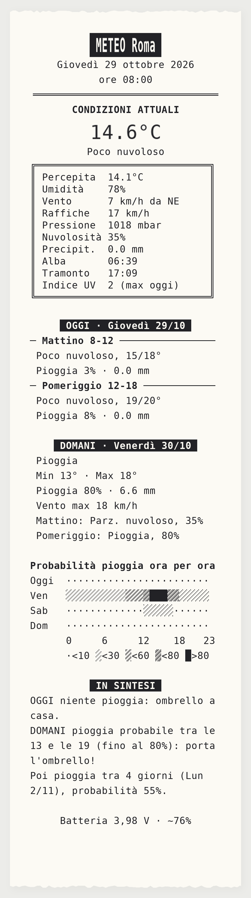
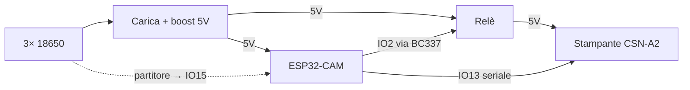

# Meteo su stampante termica

Cruscotto meteo stampato su carta termica da 58 mm. Un ESP32-CAM si sveglia dal deep sleep, scarica le previsioni da [Open-Meteo](https://open-meteo.com) (senza API key) e stampa condizioni attuali, previsioni a fasce orarie, probabilità di pioggia/neve ora per ora e lo stato della batteria.



## Funzionamento

- Stampa completa ogni giorno alle 08:00 e a ogni accensione o reset.
- Pulsante opzionale su IO14: stampa solo le condizioni attuali.
- Tra una stampa e l'altra l'ESP32 è in deep sleep; la stampante viene alimentata da un relè solo durante la stampa.
- Avviso di ricarica in fondo allo scontrino; sotto 3,2 V le stampe si sospendono.

## Schema



| Pin  | Funzione |
|------|----------|
| IO13 | TX verso RX stampante (19200 baud) |
| IO2  | Comando relè (BC337 → IN1) |
| IO15 | Tensione batteria (partitore 100k/100k) |
| IO14 | Pulsante verso GND (opzionale) |

## Hardware

- ESP32-CAM AI-Thinker (senza fotocamera né microSD)
- Stampante termica CSN-A2 (Adafruit 597)
- Modulo relè HL-52S, transistor BC337, resistenze 4,7k / 2× 100k
- 3 celle 18650 in parallelo + modulo carica/boost 5V 2A

## Software

Arduino IDE con core **esp32** di Espressif (scheda *AI Thinker ESP32-CAM*) e librerie **Adafruit Thermal Printer** e **ArduinoJson 7**.

Configurazione all'inizio di `meteo_termica_esp32cam/meteo_termica_esp32cam.ino`: WiFi, località (nome e coordinate), fuso orario, calibrazione batteria.

## Contenitore (stampa 3D)

| File | Descrizione |
|------|-------------|
| [`stl/contenitore_meteo_v2.stl`](stl/contenitore_meteo_v2.stl) | Scatola, pareti 1,4 mm, senza supporti |
| [`stl/ripiano_meteo_v2.stl`](stl/ripiano_meteo_v2.stl) | Ripiano intermedio removibile |

Livelli interni dal basso: batterie e relè, ripiano con ESP32-CAM e modulo di carica, stampante a incasso nel piano superiore.

## Struttura

```
meteo_termica_esp32cam/meteo_termica_esp32cam.ino
stl/contenitore_meteo_v2.stl
stl/ripiano_meteo_v2.stl
docs/scontrino_esempio_roma.png
```
